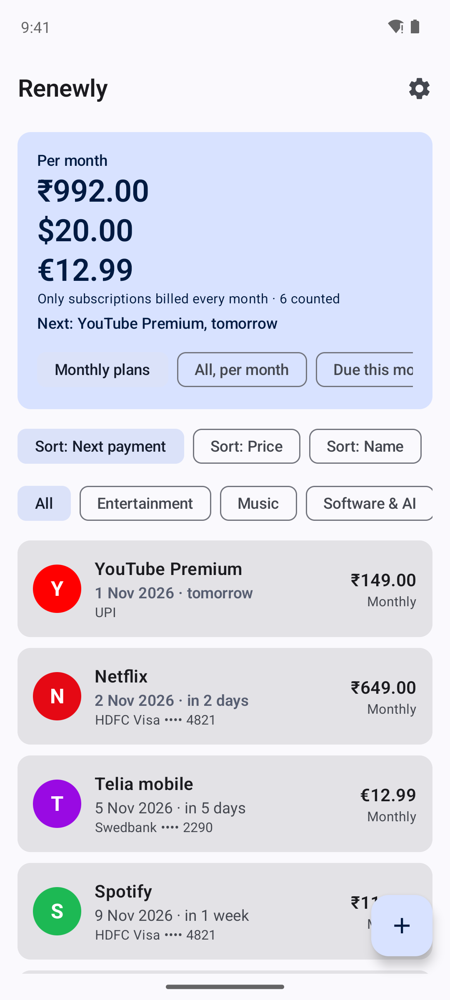
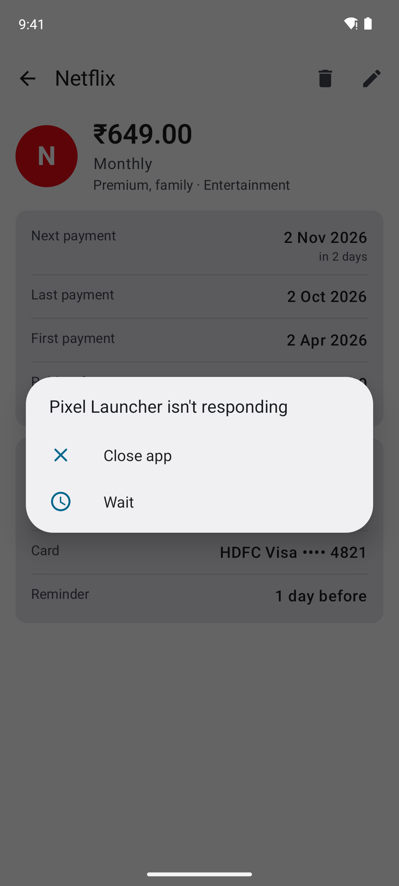
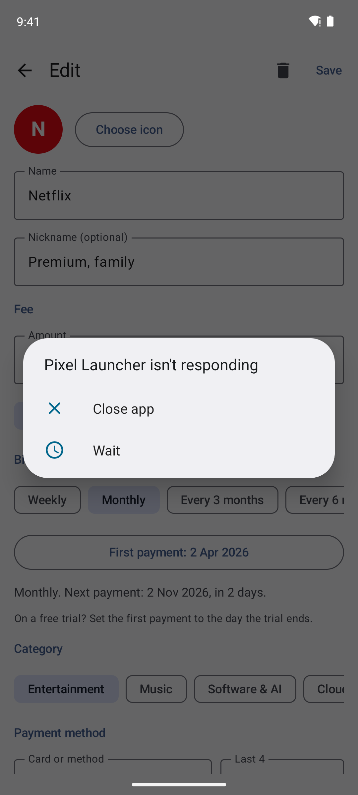
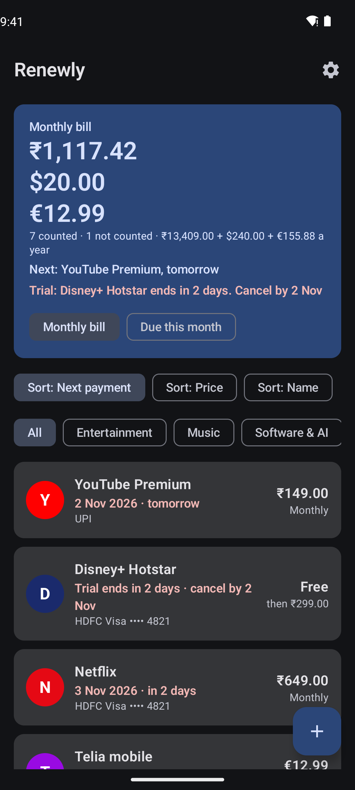

# Renewly

**An offline Android app that tracks your subscriptions and reminds you before you're charged.**

Netflix renews on the 15th, ₹649, on your HDFC card ending 4821. Renewly keeps that list, works out every next payment for you, and shows what you spend each month. Your data never leaves your phone: the app has **no internet permission**, no account, no ads and no tracking.

<p>
  
  
  
  
</p>

## Install

1. Open **[Releases](../../releases/latest)** on your phone and download `Renewly-x.y.z.apk`.
2. Open the file. If Android asks, allow your browser or Files app to **install unknown apps**.
3. If Play Protect warns about an unknown developer, tap **More details → Install anyway**. The app isn't on the Play Store, so Google doesn't know it yet.

Requires Android 8.0 or newer. Updates install over the old version and keep your data.

**Samsung Galaxy phones (One UI 6 and later):** if the install is blocked, **Auto Blocker** is on. Go to **Settings → Security and privacy → Auto Blocker**, turn it off, install Renewly, then turn it back on.

## Features

**Subscriptions**
- Name, nickname, fee and currency (₹, €, $, £)
- Any billing period: weekly, monthly, every 3 or 6 months, yearly, or custom (every 10 days, every 2 years, …)
- **Next payment**, **last payment** and **paid so far**, all worked out from the first payment date
- Month ends handled correctly: 31 Jan → 28 Feb → 31 Mar
- Payment method: a card nickname and its last 4 digits. Full card numbers are never stored
- Categories, notes, and pause without deleting

**Icons**
- Known services (Netflix, Spotify, YouTube, Prime, Hotstar, ChatGPT, iCloud, Jio, Airtel and about 40 more) get their brand colour automatically
- Use any image from your gallery as a subscription's icon

**Totals**, with three ways to count per month:
| Option | What it adds up |
|---|---|
| **Monthly plans** (default) | Only subscriptions billed every month |
| **All, per month** | Every subscription, converted to a monthly average (₹1,499/year counts as ₹125) |
| **Due this month** | What's actually charged in the current calendar month |

Different currencies are shown separately, never added together.

**Reminders**
- A notification on the day, or 1, 3 or 7 days before, or off for a subscription
- Checked every morning on the phone, without any internet

**Backup**
- Export to a JSON file you keep, and import it on a new phone. No cloud involved

## Reminders on Samsung phones

Samsung's battery saving can delay background work. In Renewly, open **Settings → Open app settings → Battery → Unrestricted**, and make sure Renewly isn't listed under **Sleeping apps** (Settings → Battery → Background usage limits).

## Privacy

| | |
|---|---|
| Internet | None. Every build fails if the app ever asks for internet access |
| Storage | A private database on your phone |
| Cloud backup | Disabled, so your data isn't copied to Google Drive |
| Card data | Only a nickname and the last 4 digits |

See [PRIVACY.md](PRIVACY.md).

## How it's built

Kotlin · Jetpack Compose · Material 3 · Room · WorkManager

| | |
|---|---|
| Tests | Unit tests cover the payment-date maths, totals, money parsing, brand matching and backups |
| Builds | Every push is tested and built by GitHub Actions; the build checks the APK has no internet permission |
| Releases | Raising the number in `version.txt` publishes a new release with the APK automatically |
| Screenshots | Taken by a robot: GitHub Actions boots an Android emulator, opens the app with sample data and saves these images |

```
app/src/main/java/com/rachitratnammudaliar/renewly/
  domain/     billing periods, payment dates, money, categories, brands
  data/       Room database, custom icons, settings
  reminders/  daily check and notifications
  backup/     JSON export and import
  ui/         Compose screens: home, details, add/edit, settings
```

### Build it yourself

Requires JDK 17 and the Android SDK.

```bash
./gradlew testDebugUnitTest assembleDebug
```

## Licence

MIT © 2026 Rachit Ratnam Mudaliar
